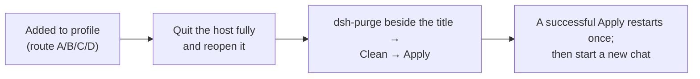

<p align="center">
  
</p>

<h1 align="center">⚔️ dsh-purge — DeepSeek Harness red-team / robustness plugin</h1>

<p align="center"><strong>Mirror rebuild v1.1.71</strong></p>

<p align="center">
  <em>Full source extracted from <code>YuJunZhiXue/dsh-purge</code> v1.1.71 (the original repo and its npm package are both gone). This repository preserves and redistributes it; the original attribution terms still apply.</em>
</p>

<p align="center">
  
  
  
  
</p>

<p align="center">
  <a href="README.md">中文</a> | <a href="README.en.md">English</a>
</p>

> **This is an extraction / mirror repository.** The publisher deleted both the GitHub repo and the npm package, so **`dsh plugin add dsh-purge` (install by package name) no longer works**. Install with the **tarball / local directory / manual** routes below. After installing you must restart the host and click **Apply** once inside **Clean** — otherwise nothing changes.

---

## Contents

- [1. What this is](#1-what-this-is)
- [2. Feature overview](#2-feature-overview)
- [3. Requirements](#3-requirements)
- [4. Install](#4-install)
  - [4.0 Pick the right host](#40-pick-the-right-host)
  - [4.1 Route A: install from this repo's tarball (recommended)](#41-route-a-install-from-this-repos-tarball-recommended)
  - [4.2 Route B: install from a local directory (offline)](#42-route-b-install-from-a-local-directory-offline)
  - [4.3 Route C: manual install (fallback)](#43-route-c-manual-install-fallback)
  - [4.4 Route D: Release zip](#44-route-d-release-zip)
  - [4.5 When `dsh` is not on PATH](#45-when-dsh-is-not-on-path)
  - [4.6 The three steps after install](#46-the-three-steps-after-install)
  - [4.7 Verification checklist](#47-verification-checklist)
- [5. Layout and runtime files](#5-layout-and-runtime-files)
- [6. Usage](#6-usage)
- [7. Config keys](#7-config-keys)
- [8. How it works](#8-how-it-works)
- [9. Update, restore, uninstall](#9-update-restore-uninstall)
- [10. FAQ](#10-faq)
- [11. Compatibility](#11-compatibility)
- [12. Notice, attribution, license](#12-notice-attribution-license)

---

<a id="1-what-this-is"></a>

## 1. What this is

`dsh-purge` is a red-team / robustness evaluation plugin for the **official DeepSeek Harness already installed on your own machine**. It does not change the model; it changes the **host layer**. Harness rewrites prompts, approval gates, sandbox policy and session migration at runtime, so "the model won't answer" is often a host-layer block rather than a model refusal. This plugin separates the two layers on your own install so you can evaluate which default policy is too tight.

| What you get | What it does |
|---|---|
| **dsh-purge dock** | A button beside the session title; right dock with two pages: **Clean** and **Drill** |
| **Clean** | Grouped patch status, Apply / Restore / Uninstall, prompt editor, multiple rule sets |
| **Drill** | Assets, skills and local environment pages after authorization (only for hosts you manage, offline targets, or a written authorized exercise) |
| **Host policy** | Default copy, permission policy, tool limits. Official capabilities stay |
| **Startup self-check** | Checks and reapplies on every start; no hand-editing after npm/pnpm overwrites `node_modules` |

Official **Web (`dsh web`)** and the official **desktop EXE** are both supported. Install and Apply them **separately**; never cross-apply.

No hardcoded drive letters: it looks at `$DSH_HOME`, then `.dsh` next to the dsh launcher, then `~/.dsh`. It never patches the Harness source tree — only local `@deepseek-ai/*` package output and user-directory override files.

---

<a id="2-feature-overview"></a>

## 2. Feature overview

- **Patches (Clean)**: per-patch `applied / pending / missing_file` status; applying repeatedly is idempotent.
- **Prompt injection**: by default injects the **encrypted prompt embedded in the plugin** (the text the prompt box shows), not a host file. You can override it with `$DSH_HOME/prompt-inject.md`.
- **Rule sets**: multiple `AGENTS.md` / `CLAUDE.md`; enabling one writes it into `$DSH_HOME`; deleting only removes it from the list.
- **Skills**: import a zip or folder into `$DSH_HOME/skills/<id>/SKILL.md` for the current host; DSH loads it. Uninstalling the plugin never deletes your skills.
- **Own servers**: register one IP or full hostname per line into `$DSH_HOME/net-scope-allow.txt`; keys, passwords, ranges and wildcards are dropped on save.
- **Rewind**: "rewind once / rewind last turn" next to the input box, or `/rewind` in chat.
- **Drill console**: first entry needs the notice, a countdown, scrolling to the end and three checkboxes. Clean does not.
- **Auto retry / auto continue**: `autoRetry` / `autoContinue`, counts configurable.

---

<a id="3-requirements"></a>

## 3. Requirements

| Item | Requirement |
|---|---|
| dsh | **0.2.x**; this package declares `dshTarget: 0.2.0-rc.2` (do not use 0.1.x) |
| Host | official desktop EXE (profile `desktop`) or official `dsh web` (profile `web`) |
| Node.js | **≥ 18**; Windows "no console flash" needs **≥ 22** |
| Package manager | dsh's bundled pnpm (used by `dsh plugin`); nothing to install |
| Network | GitHub reachable for the first install; otherwise use Route B / Route C |

---

<a id="4-install"></a>

## 4. Install

### 4.0 Pick the right host

| What you run | profile | Notes |
|---|---|---|
| Official desktop EXE (DeepSeek Harness 0.2.0-rc.2) | `desktop` | The profile exists only after the client has been started once. **Quit it fully** (tray → quit) before installing |
| Official `dsh web` | `web` | Stop the running `dsh web` first |

Confirm which `$DSH_HOME` your host actually uses (machines often have two `.dsh` directories):

```powershell
$cands = @()
if ($env:DSH_HOME) { $cands += $env:DSH_HOME }
$cands += "$env:USERPROFILE\.dsh"
$cands += @("$env:APPDATA\DeepSeek Harness\dsh-home", "$env:LOCALAPPDATA\DeepSeek Harness\dsh-home")
$cands | Select-Object -Unique | Where-Object { $_ -and (Test-Path (Join-Path $_ "profiles")) }
```

```sh
ls -d "${DSH_HOME:-$HOME/.dsh}"/profiles 2>/dev/null
```

Inside `profiles/<web|desktop>/package.json`, `"name"` must be `dsh-profile-web` or `dsh-profile-desktop`.

---

### 4.1 Route A: install from this repo's tarball (recommended)

```powershell
# Web host
dsh plugin --profile web add https://github.com/ZXEB/dsh-purge/archive/refs/heads/master.tar.gz

# Desktop host (quit the desktop client first)
dsh plugin --profile desktop add https://github.com/ZXEB/dsh-purge/archive/refs/heads/master.tar.gz
```

Same commands on macOS / Linux.

Afterwards the profile `package.json` contains:

```json
"dsh-purge": "https://github.com/ZXEB/dsh-purge/archive/refs/heads/master.tar.gz"
```

and `dsh.profile.bundles` ends with `"dsh-purge"`. **Both present = installed correctly.**

> `repository / homepage / bugs / dsh.install` in `package.json` all point at `ZXEB/dsh-purge`, so the in-panel "check for updates" and repo links use this repository instead of the dead one.

---

### 4.2 Route B: install from a local directory (offline)

```powershell
# the directory must contain package.json at its root
dsh plugin --profile desktop add D:\path\to\dsh-purge
```

```sh
dsh plugin --profile web add /path/to/dsh-purge
# or, from inside the repo root:
dsh plugin --profile web add .
```

Copy the **whole tree** (`lib/ client.js docs/ presets/ skills/ bin/`). `client.js` is the built dock front end — without it you get the CLI but no panel.

---

### 4.3 Route C: manual install (fallback)

Only touch the profile of the host you actually run.

**Step 1 — put the plugin at `$DSH_HOME/plugins/dsh-purge`**

The folder must be named `dsh-purge`, and `package.json` inside it must have `"name": "dsh-purge"`.

```sh
git clone https://github.com/ZXEB/dsh-purge.git "$DSH_HOME/plugins/dsh-purge"
```

No git: download [master.tar.gz](https://github.com/ZXEB/dsh-purge/archive/refs/heads/master.tar.gz), rename `dsh-purge-master` to `dsh-purge`, drop it into `plugins/`.

**Step 2 — edit the profile `package.json` (back it up first)**

Add exactly two things:

1. `dependencies`: `"dsh-purge": "file:../../plugins/dsh-purge"`
2. append `"dsh-purge"` to the **end** of `dsh.profile.bundles` (skip if already present)

```json
{
  "name": "dsh-profile-web",
  "private": true,
  "dependencies": {
    "dsh-purge": "file:../../plugins/dsh-purge"
  },
  "dsh": {
    "profile": {
      "bundles": [
        "@deepseek-ai/dsh-base",
        "@deepseek-ai/dsh-web-app",
        "dsh-purge"
      ]
    }
  }
}
```

JSON must stay valid. Keep the `file:` path relative; do not touch `patchReload`, other plugins or versions.

**Step 3 — install dependencies in that profile directory only**

```sh
cd "$DSH_HOME/profiles/web"    # or profiles/desktop
pnpm install
```

Success marker: `profiles/<web|desktop>/node_modules/dsh-purge/package.json` exists.

**Step 4** — see [4.6](#46-the-three-steps-after-install).

---

### 4.4 Route D: Release zip

Pushing `master` makes GitHub Actions publish a Release whose asset is `dsh-purge-<version>.zip`. Unzip it, then either use Route B against the extracted directory or Route C.

---

### 4.5 When `dsh` is not on PATH

The desktop build ships its own CLI, typically at:

```
<install dir>\resources\runtime\cli\bin\dsh.cmd
```

e.g. `D:\dsh\resources\runtime\cli\bin\dsh.cmd`. Arguments are identical:

```powershell
& "D:\dsh\resources\runtime\cli\bin\dsh.cmd" plugin --profile desktop add D:\path\to\dsh-purge
```

---

### 4.6 The three steps after install



1. **Quit and reopen** that host (tray → quit for desktop; stop and restart `dsh web`).
2. On **that host**, click **dsh-purge** beside the session title → **Clean** → **Apply** (not the Settings page).
3. **A successful Apply restarts once** so patches load; an unfinished Apply does not restart.

> Web controls affect Web only; desktop controls affect the desktop app only.

---

### 4.7 Verification checklist

- [ ] profile `package.json` has both `dependencies.dsh-purge` and `dsh-purge` in `dsh.profile.bundles`
- [ ] `profiles/<web|desktop>/node_modules/dsh-purge/package.json` exists
- [ ] the **dsh-purge** dock button appears beside the session title and opens
- [ ] `/purge status` prints `DSH_HOME` and the patch list, pointing at the host you actually run
- [ ] the model sees `purge_status` / `purge_apply` / `purge_revert` tools
- [ ] `node <plugin>/bin/dsh-purge.js --status` lists patch states

Optional packages that are missing show as `skipped` and do not block Apply.

---

<a id="5-layout-and-runtime-files"></a>

## 5. Layout and runtime files

| Path | Purpose |
|---|---|
| `bin/dsh-purge.js` | CLI entry (`--status / --apply / --revert / --uninstall / --edit`) |
| `lib/` | patch engine, path discovery, shim injection, update, uninstall, drill console (`lib/redteam/`) |
| `lib/asset-table.js` | embedded encrypted prompt (generated by `scripts/embed-default-prompt.mjs`) |
| `client.js` | built dock front end (`scripts/build-client.mjs`) |
| `cordis.patch.yml` | bundle patch registering `dsh-purge`, `dsh-purge/redteam`, `store`, `ui` |
| `presets/redteam/` | red-team preset (`agent.cordis.yml`, `anchor-gate.mjs`, `preset.yml`) |
| `skills/redteam/` | bundled skills (recon, scanning, tunnels, credentials, lateral, reporting) |
| `docs/` | banner, previews, authorization page, upstream licenses, `docs/upstream/` original READMEs |
| `scripts/` | build / embed / patch scripts, `redteam-setup.sh` |

Runtime under `$DSH_HOME` (one per host): `prompt-inject.md`, `rules/`, `skills/`, `net-scope-allow.txt`, `redteam/`, `dsh-purge/` (state: `applied.json`, `override-state.json`, `installed-rev`, `drill-grant.json`).

---

<a id="6-usage"></a>

## 6. Usage

```sh
dsh-purge --status | --apply | --revert | --uninstall | --edit | --help

/purge status | apply | revert | uninstall | edit | help
/rules list | use <id> | create <id> | delete <id> | reset | help
/skills list | import <zip-or-folder> | create <id> [desc] | delete <id> | help
/rewind

purge_status   purge_apply   purge_revert        # model tools
```

The **Clean** page lists patch status, prompt, own servers, rule sets and skills. The **Drill** page requires the first-entry authorization flow (notice → countdown → scroll → three checkboxes).

---

<a id="7-config-keys"></a>

## 7. Config keys

Edit the `dsh-purge` entry in `$DSH_HOME/profiles/<web|desktop>/cordis.patch.yml`, then restart the host.

```yaml
- insert:
    - id: dsh-purge
      name: 'dsh-purge'
      inject: [systemPrompt, tools]
      config:
        enabled: true                 # master switch
        autoApplyOnStart: false       # reapply patches on startup
        autoUpdateOnStart: false      # check for updates on startup
        autoRevertOnMissing: false    # reserved
        injectOnce: false             # reserved
        stripMnemon: true             # drop the mnemon section
        verbose: false                # verbose console logging
        postPrompt: ""                # extra prompt section (empty by default)
        postPromptOrder: 5100         # must exceed the built-in global order
        autoRetry: true
        retryMax: 3
        autoContinue: false
        continueMax: 3
        continueText: "继续"
        capabilityProtocol: true
        hooksDenyBypass: true
    - id: dsh-purge-redteam
      name: dsh-purge/redteam
    - id: dsh-purge-redteam-store
      name: dsh-purge/redteam/store
      config:
        root: !!js dshHomePath('redteam')
    - id: dsh-purge-redteam-ui
      name: dsh-purge/redteam/ui
```

The profile-level `cordis.patch.yml` (user patch layer) loads after built-in config, and later applies preserve your `insert` entries.

---

<a id="8-how-it-works"></a>

## 8. How it works

Applying (startup self-check or the Apply button) backs each target file up as `<file>.dshpurge.bak`, replaces patch targets, injects the shim (`dsh.cmd` / `dsh.ps1` / `dsh`) and the embedded encrypted prompt. Per-turn prompt source: non-empty `prompt-inject.md` → checked local md in the workspace → embedded default; the workspace-baseline policy (`strict` / `fallback` / `always`) then decides whether the DSH baseline section is kept. Skills never enter the injected section.

---

<a id="9-update-restore-uninstall"></a>

## 9. Update, restore, uninstall

```powershell
dsh plugin --profile desktop remove dsh-purge
dsh plugin --profile desktop add https://github.com/ZXEB/dsh-purge/archive/refs/heads/master.tar.gz
# quit → reopen → Clean → Apply
```

Restore keeps the plugin and returns the host to stock: `dsh-purge --revert` (or `/purge revert`). `prompt-inject.md` is a user file and is kept. Uninstall restores first, then removes the injection file, rule store and the plugin: `dsh-purge --uninstall` (or `/purge uninstall`).

Publishing a new version: bump `package.json`, put `# <version>` as the first line of `release-notes.md`, push `master` — Actions publishes the Release and zip.

---

<a id="10-faq"></a>

## 10. FAQ

1. **`add dsh-purge` returns 404** — the npm package is gone; use Route A/B/C.
2. **`pnpm was not found`** — use dsh's bundled CLI (`resources\runtime\cli\bin\dsh.cmd`).
3. **`plugin command failed`** — read the printed `logPath`; usually network, broken profile JSON, or a wrong `file:` path.
4. **Version mismatch** — this package targets dsh `0.2.0-rc.2`. If you must cross versions: `dsh plugin --profile web allow-version dsh-purge@1.1.71 --dsh-version <exact> --accept-risk`.
5. **`allowBuilds` prompt** — add the exact key pnpm prints to `profiles/<p>/pnpm-workspace.yaml`; tarball / local installs never trigger it.
6. **Desktop profile errors out** — start the desktop client once, quit it fully, retry.
7. **No dock button** — wrong host, host not restarted, missing `dsh-purge` in `dsh.profile.bundles`, or `client.js` not copied.
8. **Applied but nothing changed** — patches load after a restart, and injection enters a **new** session. Apply → let it restart → start a new chat.
9. **Everything `pending` / `missing_file`** — the host was upgraded or moved; unmatched patches are skipped, never blindly rewritten.
10. **`node_modules` overwritten** — set `autoApplyOnStart: true`, or click Apply again.
11. **Back to a stock Harness** — restore, then uninstall, then remove `$DSH_HOME/dsh-purge/`.
12. **Other machines / clients** — yes; the plugin only talks to the local `@deepseek-ai` packages and `$DSH_HOME`.

---

<a id="11-compatibility"></a>

## 11. Compatibility

| Plugin | dsh | Notes |
|---|---|---|
| **1.1.71** (this repo) | **0.2.x** (desktop 0.2.0-rc.2 / `dsh web`) | full extraction |
| 1.1.40+ | 0.2.x | same line upstream |
| ≤ 1.1.39 | 0.1.7 (incl. rc.1/rc.2) | older upstream line, not included here |

---

<a id="12-notice-attribution-license"></a>

## 12. Notice, attribution, license

**Attribution (original author's terms):** if you borrow this project's name, ideas, code or prompts, you must credit the author and name the source. Original: **`YuJunZhiXue/dsh-purge` (author: 小杨)**. This repository is the v1.1.71 mirror rebuild: **`ZXEB/dsh-purge`**.

**Scope**

1. No malware, backdoors, unauthorized pentest kits, ransomware, credential-stuffing scripts or attack payloads aimed at the public internet.
2. Patches and prompt injection only affect the **official DeepSeek Harness installed on your own machine** (`@deepseek-ai` packages, local profile / `$DSH_HOME`).
3. Apply / inject / revert / uninstall touch local files and local processes only; nothing scans, probes or sends traffic to public hosts. The update check contacts this plugin's own GitHub repository to compare versions.
4. Use only on a Harness you are entitled to administer, offline synthetic fixtures, authorized ranges or compliant labs.
5. Network ranges in mainland China, Hong Kong and Macau, and servers/domains resolving into them, are forbidden by default; the only exception is the single exact IP or full hostname you register in advance (Clean → Own servers → `$DSH_HOME/net-scope-allow.txt`). Keys, passwords, ranges, wildcards and verbal claims are not exceptions.
6. Do not use it to violate applicable law or the model provider's terms; no unauthorized intrusion, extortion, credential stuffing or malware distribution.
7. Provided as-is under MIT; users bear all responsibility for download, deployment, operation, modification, distribution and outputs.
8. Any illegal use terminates the license immediately and irrevocably.
9. Independent open-source research project; no affiliation with, or endorsement by, DeepSeek.

**License**: MIT — see [LICENSE](LICENSE) (original copyright line `Copyright (c) 2026 小杨` retained).

**Thanks**: original author 小杨 (`YuJunZhiXue`), the [LINUX DO](https://linux.do) community, and the upstream projects listed in `docs/redteam-upstream-*`.
