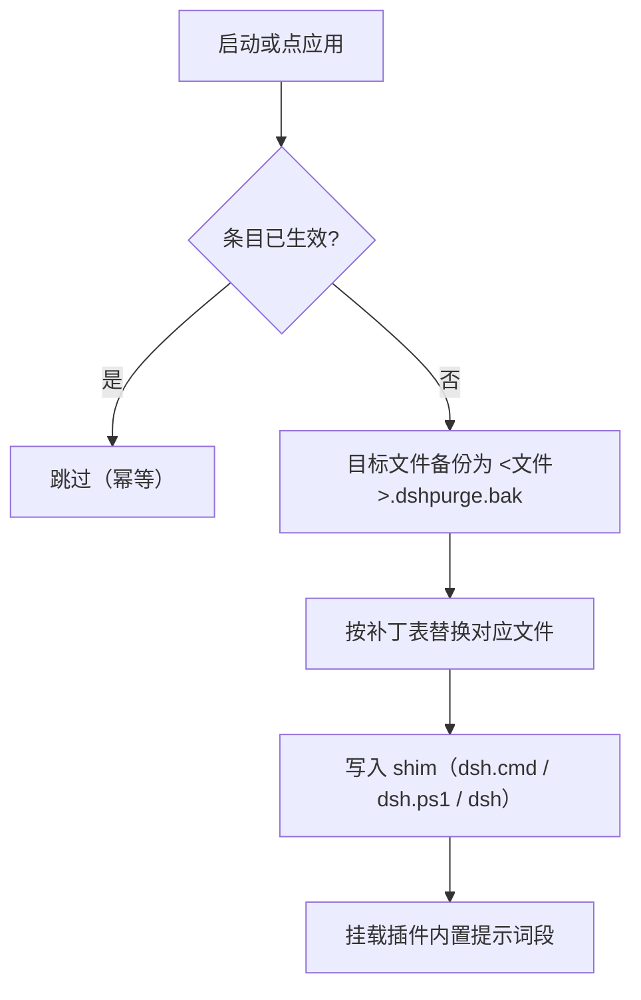

<p align="center">
  
</p>

<h1 align="center">dsh-purge — DeepSeek Harness 本地运行时适配插件</h1>

<p align="center"><strong>适配版 v1.1.77 · 对应 dsh 0.2.2-rc.5</strong></p>

<p align="center">
  <a href="https://github.com/ZXEB/dsh-purge/releases"></a>
  
  
  
  <a href="https://zxeb.github.io/dsh-purge/"></a>
</p>

<p align="center">
  <a href="README.md">中文</a> ·
  <a href="README.en.md">English</a> ·
  <a href="#四安装">快速安装</a> ·
  <a href="https://zxeb.github.io/dsh-purge/">插件市场源</a> ·
  <a href="https://github.com/ZXEB/dsh-purge/releases/latest">最新发行包</a> ·
  <a href="ADAPTATION-NOTES.md">适配记录</a>
</p>

> **30 秒极速安装（推荐）**：打开 DSH **「插件 → 发现 → 添加索引源」**（若无「发现」，先在「插件 → 实验性插件 → 更多」启用「自定义插件市场 / 自定义插件索引」），粘贴下方网址并保存，找到 **dsh-purge** 点击「安装」即可：
>
> ```text
> https://zxeb.github.io/dsh-purge/index.json
> ```
>
> 本插件**零第三方 npm 运行依赖**（不会遇到 npm 镜像 404），同时支持直链 `.tgz`、跨平台一键远程脚本与离线安装，详见 [四、安装](#四安装) 与 [INSTALL-OTHER-PC.md](INSTALL-OTHER-PC.md)。

---

## 目录

- [一、这是什么](#一这是什么)
- [二、能力总览](#二能力总览)
- [三、环境要求](#三环境要求)
- [四、安装](#四安装)
- [五、目录结构与运行时文件](#五目录结构与运行时文件)
- [六、使用](#六使用)
- [七、配置项](#七配置项)
- [八、工作方式](#八工作方式)
- [九、更新、还原、卸载](#九更新还原卸载)
- [十、常见问题（FAQ）](#十常见问题faq)
- [十一、兼容性](#十一兼容性)
- [十二、署名与许可](#十二署名与许可)

---

<a id="一这是什么"></a>

## 一、这是什么

`dsh-purge` 是给**本机已安装的官方 DeepSeek Harness** 使用的一个插件。它不加载模型权重、不修改 Harness 源码树，只在**宿主层**做两类事情：

1. **统一本地默认值**。Harness 的许多行为由若干默认常量与默认策略决定（提示词段落措辞、审批策略默认值、沙箱模式默认值、工具描述文本、交付物卡片行为等）。这些值在官方包里是写死的；本插件用一张**可回滚的补丁表**把它们在你本机改成同一套统一取值，行为一致、可随时还原。
2. **集中查看与维护**。侧栏面板按组列出每个条目的状态（`applied` / `pending` / `skipped` / `missing_file`），支持一键应用、还原、卸载，以及提示词段与规则集的编辑。

| 你会得到 | 说明 |
|---|---|
| **侧栏面板** | 会话标题旁的按钮，右侧栏两页：**适配** / **工作台（可选模块）** |
| **适配页** | 分组显示补丁状态；应用 / 还原 / 卸载；提示词编辑；多套规则集 |
| **工作台** | 本机资产与技能清点页，首次进入需确认授权声明；不使用可以完全不进 |
| **宿主默认值** | 提示词段、权限策略、工具上限、卡片行为统一取值；官方能力保留 |
| **启动自检** | 可选开启；npm/pnpm 重装覆盖 `node_modules` 后不必手改文件 |

支持官方 **Web（`dsh web`）** 与官方**桌面 EXE**；两个宿主是两份独立的 `$DSH_HOME`，**分别安装、分别应用**。

路径探测顺序：`$DSH_HOME` → dsh 启动器旁的 `.dsh` → `~/.dsh`。不改 Harness 源码树，只改本机 `@deepseek-ai/*` 包产物与用户目录下的覆盖文件。

---

<a id="二能力总览"></a>

## 二、能力总览

- **补丁表**：按组列出每项状态，重复应用幂等；原文对不上的条目只显示 `skipped`，不会乱改。
- **提示词段**：默认使用插件内**加密内置**的那份；也可编辑器里的 `$DSH_HOME/prompt-inject.md` 覆盖。
- **规则集**：多套 `AGENTS.md` / `CLAUDE.md`，启用即写入 `$DSH_HOME`，删除只从列表移除。
- **Skill**：导入压缩包或文件夹到当前宿主的 `$DSH_HOME/skills/<id>/SKILL.md`，由 DSH 自己加载；卸载插件不删你的 Skill。
- **本机地址清单**：面板里逐行登记设备 IP 或完整主机名，写入 `$DSH_HOME/net-scope-allow.txt`（仅记录用途，用于本地资产清点）。
- **回退**：输入框旁「回退一次 / 回退上一轮」，已发送内容回到输入框，可从当前这一轮重来；聊天里 `/rewind` 等价。
- **自动重试 / 续跑**：`autoRetry` 失败重试、`autoContinue` 自动续跑，次数可配。

---

<a id="三环境要求"></a>

## 三、环境要求

| 项 | 要求 |
|---|---|
| dsh | **0.2.2-rc.5**（兼容范围 `>=0.2.0-rc.1 <0.3.0`，0.2.0 / 0.2.1 / 0.2.2-rc.1~rc.5 均可用） |
| 宿主 | 官方桌面 EXE（profile `desktop`）或官方 `dsh web`（profile `web`） |
| Node.js | **≥ 18**；Windows 下要「无闪窗」需要 **≥ 22** |
| 包管理器 | 使用 DSH 自带的 pnpm（`dsh plugin` 会自动调用），不必单独安装 |
| 网络与依赖 | **零第三方 npm 运行依赖**；联网支持自定义市场网址 / `.tgz` 一键装，无网支持离线包安装 |

---

<a id="四安装"></a>

## 四、安装

**让 AI 帮你装**，直接把下面这句话发给能操作本机的 Agent：

> 帮我把 https://github.com/ZXEB/dsh-purge 的最新稳定版安装到我正在用的 DeepSeek Harness（优先通过自定义插件索引 `https://zxeb.github.io/dsh-purge/index.json` 或最新 GitHub Release `.tgz` 安装）。装好后告诉我实际版本和 profile，由我自己重启 DSH。

---

### 4.1 方式一：DSH 官方界面「自定义插件市场」一键安装（最简单，推荐）

新版 DSH 支持通过一个网址直接添加插件索引并在界面里点击安装，无需下载压缩包、无需配置本地路径：

1. 打开 DSH 的 **「插件 → 发现 → 添加索引源」**。如果没有看到「发现」标签页，先到 **「插件 → 实验性插件 → 更多」** 打开 **「自定义插件市场 / 自定义插件索引」**。
2. 在「添加索引源」里粘贴下面这一行网址并保存：

   ```text
   https://zxeb.github.io/dsh-purge/index.json
   ```

3. 在「发现」列表中找到 **dsh-purge**（核对仓库为 `ZXEB/dsh-purge`），点击 **「安装」** 即可。

> 本插件**不依赖任何第三方 npm 包**（`dependencies` 为空），安装时不会因为 npm 镜像缺包报 404，也无需授权任何构建脚本。

---

### 4.2 方式二：DSH 官方界面「添加插件」或 CLI 直接填 `.tgz` 网址安装

如果你的 DSH 界面没有启用「发现」，或者习惯直接命令行安装，可以直接粘贴稳定版 `.tgz` 下载链接：

- **DSH 桌面 / Web 界面**：打开 **「插件 → 添加插件」**，在「包名或地址」中粘贴下方链接并确认安装：

  ```text
  https://github.com/ZXEB/dsh-purge/releases/download/v1.1.77/dsh-purge-1.1.77.tgz
  ```

- **DSH 官方 CLI**（桌面版请把 `web` 改为 `desktop`，且确保与正在使用的 `DSH_HOME` 一致）：

  ```sh
  # Web 宿主
  dsh plugin --profile web add "https://github.com/ZXEB/dsh-purge/releases/download/v1.1.77/dsh-purge-1.1.77.tgz"

  # 桌面宿主（建议先完全退出桌面客户端）
  dsh plugin --profile desktop add "https://github.com/ZXEB/dsh-purge/releases/download/v1.1.77/dsh-purge-1.1.77.tgz"
  ```

> 也可以前往 [GitHub Releases 最新版](https://github.com/ZXEB/dsh-purge/releases/latest) 复制对应版本的 `dsh-purge-版本号.tgz` 链接。不要替换为裸包名 `dsh plugin add dsh-purge`（原 npm 包已下线）。

---

### 4.3 方式三：一键远程安装脚本（免手动下载，带 SHA256 校验）

不需要手动下载压缩包或克隆仓库。脚本会自动获取最新稳定 Release、对照 `SHA256SUMS.txt` 校验完整性、备份当前 profile 的 `package.json`，再调用官方 `dsh plugin add` 安装（不修改全局 PATH、代理或自动重启 DSH）。

#### Windows（PowerShell 5.1 / 7）

```powershell
$Installer = Join-Path $env:TEMP ('dsh-purge-install-' + [guid]::NewGuid().ToString('N') + '.ps1')
Invoke-WebRequest -UseBasicParsing -TimeoutSec 90 -Uri 'https://raw.githubusercontent.com/ZXEB/dsh-purge/master/scripts/install.ps1' -OutFile $Installer
powershell -NoProfile -ExecutionPolicy Bypass -File "$Installer" -DryRun
```

确认输出的版本、SHA256、目标 `DSH_HOME` 与 `profile` 无误后，执行正式安装（默认 `desktop`，Web 宿主加 `-Profile web`）：

```powershell
powershell -NoProfile -ExecutionPolicy Bypass -File "$Installer"
```

#### macOS / Linux

```sh
TMP_DIR="$(mktemp -d)"
curl -fsSL --connect-timeout 20 --max-time 90 "https://raw.githubusercontent.com/ZXEB/dsh-purge/master/scripts/install.sh" -o "$TMP_DIR/install.sh"
sh "$TMP_DIR/install.sh" --dry-run
```

确认无误后执行正式安装（可按需追加 `--profile=desktop` 或 `--profile=web`）：

```sh
sh "$TMP_DIR/install.sh"
```

---

### 4.4 方式四：离线本地目录 / 手动安装（无网环境兜底）

如果目标电脑无法访问 GitHub，可从 [Releases](https://github.com/ZXEB/dsh-purge/releases/latest) 下载 `dsh-purge-1.1.77.tgz` 或 `dsh-purge-1.1.77.zip` 拷贝过去离线安装：

- **直接安装本地 `.tgz`**：
  ```powershell
  dsh plugin --profile desktop add D:\dsh-plugins\dsh-purge-1.1.77.tgz
  ```
- **解压源码包后用本地脚本（Windows）**：解压到纯英文路径（如 `D:\dsh-plugins\dsh-purge`），运行：
  ```powershell
  powershell -ExecutionPolicy Bypass -File .\check.ps1 -Profile desktop
  powershell -ExecutionPolicy Bypass -File .\install.ps1 -Profile desktop
  ```
- **纯手工兜底**（CLI 不可用时）：详见 [INSTALL-OTHER-PC.md](INSTALL-OTHER-PC.md)（复制目录到 `$DSH_HOME/plugins/dsh-purge`，在 `profiles/<web|desktop>/package.json` 的 `dependencies` 与 `dsh.profile.bundles` 登记 `dsh-purge`，再执行 `pnpm install`）。

如果 `dsh` 不在 `PATH` 中，桌面版自带 CLI 位于 `<安装目录>\resources\runtime\cli\bin\dsh.cmd`，可直接用完整路径调用，参数完全一致。

---

### 4.5 安装后的三步

1. **完全退出并重开**你装的那个宿主：桌面端托盘右键退出再开；`dsh web` 停进程再启动。
2. 在**那个宿主**上点会话标题旁的 **dsh-purge** → **适配** → **应用**（不在设置页里）。
3. 应用成功后宿主会自重启一次（补丁在重启后加载）；重启后新开一轮对话即生效。

> Web 与桌面是两份独立的 profile，分别安装、分别应用。
> 也可以纯命令行应用：`node <profile>\node_modules\dsh-purge\bin\dsh-purge.js --apply`。

---

### 4.6 安装验证清单

- [ ] `profiles/<web|desktop>/package.json` 里同时有 `dependencies.dsh-purge` 和 `dsh.profile.bundles` 里的 `dsh-purge`
- [ ] `profiles/<web|desktop>/node_modules/dsh-purge/package.json` 存在且版本为 `1.1.77`
- [ ] 宿主界面会话标题旁出现 **dsh-purge** 按钮，右侧栏能打开
- [ ] 聊天里 `/purge status` 打印 `DSH_HOME` 与补丁列表，且路径是你实际在跑的那份
- [ ] 模型侧有 `purge_status` / `purge_apply` / `purge_revert` 三个工具（说明 bundle 已加载）

可选包（例如第三方 mnemon / liangshen 相关条目）没装时显示 `skipped` / `missing_file`，不阻塞应用，属正常。

---

<a id="五目录结构与运行时文件"></a>

## 五、目录结构与运行时文件

包内：

| 路径 | 说明 |
|---|---|
| `bin/dsh-purge.js` | CLI 入口（`--status / --apply / --revert / --uninstall / --edit`） |
| `lib/` | 补丁引擎、路径探测、shim 写入、更新、卸载、扩展工作台（`lib/redteam/`） |
| `lib/core.js` | 补丁表与匹配引擎（本适配版的主要改动都在这里） |
| `lib/asset-table.js` | 内置加密提示词（由 `scripts/embed-default-prompt.mjs` 生成） |
| `client.js` | 侧栏前端产物（构建自 `scripts/build-client.mjs`） |
| `cordis.patch.yml` | bundle patch：注册 `dsh-purge`、`dsh-purge/redteam`、`store`、`ui` 四个入口 |
| `presets/` / `skills/` | 预设与随包技能（可选模块用） |
| `scripts/` | 远程一键安装脚本（`install.ps1` / `install.sh`）、市场索引生成（`build-market.mjs`）及构建脚本 |
| `market/` | DSH 官方 format 1 市场索引校验器与说明 |

运行时（`$DSH_HOME` 下，Web 与桌面各一份）：

| 文件/目录 | 说明 |
|---|---|
| `prompt-inject.md` | 会话覆盖段；用户文件，还原时保留 |
| `rules/` | 规则集（`AGENTS.md` / `CLAUDE.md`） |
| `skills/<id>/SKILL.md` | 导入的技能 |
| `net-scope-allow.txt` | 本机设备地址清单 |
| `redteam/` | 工作台本地状态库（SQLite，可选模块） |
| `dsh-purge/` | 插件状态：`applied.json`、`override-state.json`、`installed-rev` 等 |

---

<a id="六使用"></a>

## 六、使用

```sh
# 命令行
dsh-purge --status       # 宿主、DSH_HOME、补丁 applied/pending、shim、备份
dsh-purge --apply        # 应用全部补丁（提示词段 + 代码默认值 + shim + override）
dsh-purge --revert       # 回滚还原
dsh-purge --uninstall    # 卸载（已应用则先还原）
dsh-purge --edit         # 编辑注入文件 prompt-inject.md
dsh-purge --help

# 聊天命令
/purge status | apply | revert | uninstall | edit | help
/rules list | use <id> | create <id> | delete <id> | reset | help
/skills list | import <压缩包或文件夹> | create <id> [说明] | delete <id> | help
/rewind

# 模型工具
purge_status   purge_apply   purge_revert
```

面板：**适配** 页从上到下是补丁状态、提示词、本机地址清单、规则集、Skill；**工作台** 页首次进入需确认声明（读声明 → 等倒计时 → 滚到文末 → 勾三项）。

---

<a id="七配置项"></a>

## 七、配置项

改 `$DSH_HOME/profiles/<web|desktop>/cordis.patch.yml` 里的 `dsh-purge` 条目，**重启宿主**生效：

```yaml
- insert:
    - id: dsh-purge
      name: 'dsh-purge'
      inject: [systemPrompt, tools]
      config:
        enabled: true                 # 插件总开关
        autoApplyOnStart: false       # 启动时自动应用（默认关）
        autoUpdateOnStart: false      # 启动时检查更新
        autoRevertOnMissing: false    # 保留字段
        injectOnce: false             # 保留字段
        stripMnemon: true             # 去掉 mnemon 段
        verbose: false                # 控制台详细日志
        postPrompt: ""                # 额外提示段（默认空）
        postPromptOrder: 5100         # 需大于内置全局顺序，否则该段被跳过
        autoRetry: true               # 失败自动重试
        retryMax: 3
        autoContinue: false           # 自动续跑
        continueMax: 3
        continueText: "继续"
        capabilityProtocol: true      # 注入能力协议段
        hooksDenyBypass: true
    - id: dsh-purge-redteam
      name: dsh-purge/redteam
    - id: dsh-purge-redteam-store
      name: dsh-purge/redteam/store
      config:
        root: !!js dshHomePath('redteam')
    - id: dsh-purge-redteam-ui
      name: dsh-purge/redteam/ui
```

profile 层的 `cordis.patch.yml`（用户 patch 层）在内置配置之后加载，后续应用插件会保留你的 `insert`。

---

<a id="八工作方式"></a>

## 八、工作方式



提示词段来源优先级：`prompt-inject.md`（非空）→ 当前目录被勾选且非空的本地 md → 插件内置默认值；再由 workspace baseline 策略（`strict` / `fallback` / `always`）决定是否保留 DSH 的 baseline 段。Skill **不进**注入段，也不顶替提示词。

补丁匹配是**纯文本锚点**：锚点对不上（上游改了写法）就判 `skipped` 并保持原样，不会产生半改文件；本适配版已按 dsh 0.2.2-rc.5 的实际产物逐条校准（见 [ADAPTATION-NOTES.md](ADAPTATION-NOTES.md)）。

---

<a id="九更新还原卸载"></a>

## 九、更新、还原、卸载

**还原**（保留插件，只回原版宿主）：

```sh
dsh-purge --revert        # 或 /purge revert，或面板「还原」
```

- 每个目标文件应用前备份为 `<文件>.dshpurge.bak`；还原用备份覆盖回去并删除备份；没有备份时只去掉 shim 里由本插件写入的行。
- `prompt-inject.md` 是用户文件，还原时保留。

**卸载**：

```sh
dsh-purge --uninstall     # 或 /purge uninstall，或面板「适配 → 卸载」
```

会先还原（若已应用）再删除注入文件、规则库与插件登记，然后重启宿主。

**升级到新版**：
- 通过 DSH 自定义插件市场安装的用户，可直接在 DSH「插件」页检查并一键升级；
- 通过 `.tgz` 或远程脚本安装的用户，直接重新运行新版 `.tgz` 安装命令或 `scripts/install.ps1` / `install.sh` 即可；
- 升级并重启宿主后，进入面板重新点击一次「应用」。npm/pnpm 覆盖 `node_modules` 后补丁会重置，把 `autoApplyOnStart` 设成 `true` 可自动补回。

---

<a id="十常见问题faq"></a>

## 十、常见问题（FAQ）

**1. `dsh plugin add dsh-purge` 装不上**
原 npm 包已下线。请使用 [4.1 自定义插件市场一键安装](#41-方式一dsh-官方界面自定义插件市场一键安装最简单推荐)（粘贴 `https://zxeb.github.io/dsh-purge/index.json`）或 [4.2 直接填入 `.tgz` 网址](#42-方式二dsh-官方界面添加插件或-cli-直接填-tgz-网址安装)。

**2. `dsh plugin` 报 `pnpm was not found`**
用 dsh 自带 CLI（`<安装目录>\resources\runtime\cli\bin\dsh.cmd`），它会带内置 pnpm；自己装的话确保 pnpm 在 PATH。

**3. 报 `plugin command failed`**
查看报错给出的 `logPath`。常见原因是 profile `package.json` 语法损坏、Windows 路径含中文导致 pnpm store 锁冲突（远程脚本与 `install.ps1` 会自动规避）或本地文件路径失效。

**4. 报版本不匹配（incompatible）**
本包已在 `package.json` 声明 `engines.dsh: ">=0.2.0-rc.1 <0.3.0"`，覆盖全部 0.2.x 版本。如果未来跨大版本需要强制放行，可执行：

```sh
dsh plugin --profile web allow-version dsh-purge@1.1.77 --dsh-version <你的精确版本> --accept-risk
```

**5. 桌面端 `dsh plugin --profile desktop ...` 直接报错**
桌面 profile 还没初始化：先启动一次桌面客户端，**完全退出**后再跑命令。

**6. 装好了但会话标题旁没有 dsh-purge**
- 装到了另一个宿主（桌面版使用 `desktop` profile，命令行 `dsh web` 使用 `web` profile，两者各自独立）；
- 还没有完全退出并重启宿主；
- 手动安装时漏加了 `dsh.profile.bundles` 里的 `"dsh-purge"`（只加 `dependencies` 不会加载）；
- 离线拷贝目录时漏拷了 `client.js`。

**7. 点了「应用」但行为没变**
补丁要**重启后**才加载。正确顺序：应用 → 等自动重启 → 新开一轮对话。

**8. 状态里出现 `skipped` / `missing_file`**
宿主版本不同或装了精简产物，锚点对不上时只显示跳过（不会乱改）。缺失项对应的可选包（第三方 mnemon / liangshen 等）没装时属正常，其余仍能完成。

**9. 想在另一台电脑上用**
有网络时直接在新电脑的 DSH「插件 → 发现 → 添加索引源」填入 `https://zxeb.github.io/dsh-purge/index.json` 一键安装即可；完全离线环境请参考 [INSTALL-OTHER-PC.md](INSTALL-OTHER-PC.md) 拷贝 `.tgz` 或 `.zip` 安装。

---

<a id="十一兼容性"></a>

## 十一、兼容性

| 插件版本 | 适配 dsh | 说明 |
|---|---|---|
| **1.1.77**（当前版） | **0.2.2-rc.5**（`>=0.2.0-rc.1 <0.3.0`） | 新增 DSH 官方 format 1 自定义插件市场索引（`https://zxeb.github.io/dsh-purge/index.json`）、标准 `.tgz` Release 发行包与跨平台一键远程安装脚本；声明 `engines.dsh` 兼容范围 |
| 1.1.76 | 0.2.2-rc.5 | 适配 rc.5 全部 332 包 + `pi-ai@1.6`；补齐扩展预设/子代理接口/`CONTENT_REFUSED`，恢复 `#32` `#40` `#56` `#77` `#57` 并修复首次升级重复解包 |
| 1.1.76 同版向下 | 0.2.2-rc.1~rc.4、0.2.1-rc.x、0.2.0-rc.2 | 状态探测 **0 回归**，旧写法锚点与 `listChildren` 回退均保留 |
| 1.1.75 | 0.2.2-rc.3 | 修复 `{{cwd}}` 变量缺失、组装兜底丢工具与 DSML 正文重试 |
| 1.1.73–1.1.74 | 0.2.2-rc.3 | 锚点重校准 + 读前校验与 hooks 幂等修复 |
| 1.1.71（上游镜像） | 0.2.0-rc.2 | 原仓库镜像版，0.2.2 上有 6 条锚点失效 |

未命中项在面板里显示 `skipped`，只影响那一条，不会产生半改文件。在 0.2.2 桌面端应用后常态 `skipped` 仅剩 `#80`（旧版极简工具表回退项）与 `#82`（旧版桌面回退项）。

不适配的条目不会被盲改，只会 `pending` / `skipped`。

---

<a id="十二署名与许可"></a>

## 十二、署名与许可

本项目为 MIT 开源。署名要求沿用原作者条款：借用名称、思路、代码或提示词须署名并写明来源。原始来源：**`YuJunZhiXue/dsh-purge`（作者：小杨）**；镜像重建：**`ZXEB/dsh-purge`**；本目录为适配重建。

使用范围：本插件只作用于**你自己电脑上已安装的 Harness**（本机 `@deepseek-ai` 包、本地 profile 与 `$DSH_HOME`），以及你有权管理的环境。请勿将其用于他人的设备、账号或信息系统。

本项目按 MIT「现状」提供，不担保完整性与适用性；部署、运行、修改、分发及其产生的一切结果由使用者自行承担。

**许可**：MIT，见 [LICENSE](LICENSE)（版权行保留原作者 `Copyright (c) 2026 小杨`）。
