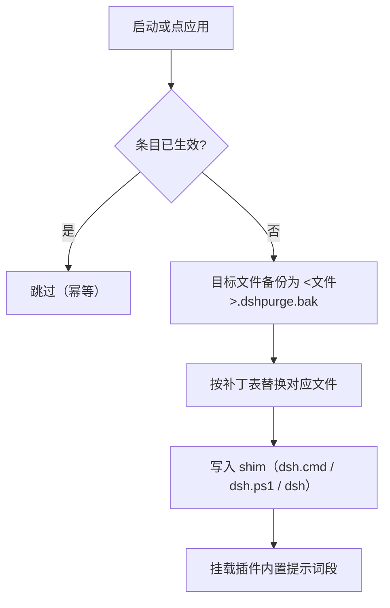

<p align="center">
  
</p>

<h1 align="center">dsh-purge — DeepSeek Harness 本地运行时适配插件</h1>

<p align="center"><strong>适配版 v1.1.76 · 对应 dsh 0.2.2-rc.5</strong></p>

<p align="center">
  
  
  
  
</p>

<p align="center">
  <a href="README.md">中文</a> | <a href="README.en.md">English</a>
</p>

> 本包是 `dsh-purge` 的**兼容性适配重建版**，用于给自己电脑上已安装的官方 DeepSeek Harness 做本地配置与产物层适配。原仓库与其 npm 包均已下线，因此**按包名安装（`dsh plugin add dsh-purge`）不可用**，请按本文第四节的 tarball / 本地目录 / 手动三种方式安装。
>
> 本版本针对 **dsh 0.2.2-rc.5** 重新校准了补丁锚点与运行期接口，适配细节见 [ADAPTATION-NOTES.md](ADAPTATION-NOTES.md)。
>
> 要在**另一台电脑**上装：直接看 [INSTALL-OTHER-PC.md](INSTALL-OTHER-PC.md)（拷贝 zip → 解压到英文路径 → 跑 `install.ps1`）。

---

## 目录

- [一、这是什么](#一这是什么)
- [二、能力总览](#二能力总览)
- [三、环境要求](#三环境要求)
- [四、安装](#四安装)
- [五、目录结构与运行时文件](#五目录结构与运行时文件)
- [六、使用](#六使用)
- [七、配置项](#七配置项)
- [八、工作方式](#八工作方式)
- [九、更新、还原、卸载](#九更新还原卸载)
- [十、常见问题（FAQ）](#十常见问题faq)
- [十一、兼容性](#十一兼容性)
- [十二、署名与许可](#十二署名与许可)

---

<a id="一这是什么"></a>

## 一、这是什么

`dsh-purge` 是给**本机已安装的官方 DeepSeek Harness** 使用的一个插件。它不加载模型权重、不修改 Harness 源码树，只在**宿主层**做两类事情：

1. **统一本地默认值**。Harness 的许多行为由若干默认常量与默认策略决定（提示词段落措辞、审批策略默认值、沙箱模式默认值、工具描述文本、交付物卡片行为等）。这些值在官方包里是写死的；本插件用一张**可回滚的补丁表**把它们在你本机改成同一套统一取值，行为一致、可随时还原。
2. **集中查看与维护**。侧栏面板按组列出每个条目的状态（`applied` / `pending` / `skipped` / `missing_file`），支持一键应用、还原、卸载，以及提示词段与规则集的编辑。

| 你会得到 | 说明 |
|---|---|
| **侧栏面板** | 会话标题旁的按钮，右侧栏两页：**适配** / **演练台（可选模块）** |
| **适配页** | 分组显示补丁状态；应用 / 还原 / 卸载；提示词编辑；多套规则集 |
| **演练台** | 本机资产与技能清点页，首次进入需确认授权声明；不使用可以完全不进 |
| **宿主默认值** | 提示词段、权限策略、工具上限、卡片行为统一取值；官方能力保留 |
| **启动自检** | 可选开启；npm/pnpm 重装覆盖 `node_modules` 后不必手改文件 |

支持官方 **Web（`dsh web`）** 与官方**桌面 EXE**；两个宿主是两份独立的 `$DSH_HOME`，**分别安装、分别应用**。

路径探测顺序：`$DSH_HOME` → dsh 启动器旁的 `.dsh` → `~/.dsh`。不改 Harness 源码树，只改本机 `@deepseek-ai/*` 包产物与用户目录下的覆盖文件。

---

<a id="二能力总览"></a>

## 二、能力总览

- **补丁表**：按组列出每项状态，重复应用幂等；原文对不上的条目只显示 `skipped`，不会乱改。
- **提示词段**：默认使用插件内**加密内置**的那份；也可编辑器里的 `$DSH_HOME/prompt-inject.md` 覆盖。
- **规则集**：多套 `AGENTS.md` / `CLAUDE.md`，启用即写入 `$DSH_HOME`，删除只从列表移除。
- **Skill**：导入压缩包或文件夹到当前宿主的 `$DSH_HOME/skills/<id>/SKILL.md`，由 DSH 自己加载；卸载插件不删你的 Skill。
- **本机地址清单**：面板里逐行登记设备 IP 或完整主机名，写入 `$DSH_HOME/net-scope-allow.txt`（仅记录用途，用于本地资产清点）。
- **回退**：输入框旁「回退一次 / 回退上一轮」，已发送内容回到输入框，可从当前这一轮重来；聊天里 `/rewind` 等价。
- **自动重试 / 续跑**：`autoRetry` 失败重试、`autoContinue` 自动续跑，次数可配。

---

<a id="三环境要求"></a>

## 三、环境要求

| 项 | 要求 |
|---|---|
| dsh | **0.2.2-rc.5**（本包 `dshTarget`）；0.2.0 / 0.2.1 / 0.2.2-rc.1~rc.4 亦可用，个别条目会显示 `skipped` |
| 宿主 | 官方桌面 EXE（profile `desktop`）或官方 `dsh web`（profile `web`） |
| Node.js | **≥ 18**；Windows 下要「无闪窗」需要 **≥ 22** |
| 包管理器 | 用 dsh 自带的 pnpm（`dsh plugin` 会调用它），不必单独装 |
| 网络 | 本包已适配本地目录安装，**不需要联网**即可完成安装 |

---

<a id="四安装"></a>

## 四、安装

### 4.0 先确认装到哪个宿主

| 你在跑 | profile | 说明 |
|---|---|---|
| 官方桌面 EXE | `desktop` | profile 需**先启动过一次客户端**才生成；安装前**完全退出**（托盘右键退出） |
| 官方 `dsh web` | `web` | 安装前停掉正在跑的 `dsh web` |

确认 `$DSH_HOME` 是你实际在用的那一份（本机常有两份 `.dsh`）：

```powershell
$cands = @()
if ($env:DSH_HOME) { $cands += $env:DSH_HOME }
$cands += "$env:USERPROFILE\.dsh"
$cands += @("$env:APPDATA\DeepSeek Harness\dsh-home", "$env:LOCALAPPDATA\DeepSeek Harness\dsh-home")
$cands | Select-Object -Unique | Where-Object { $_ -and (Test-Path (Join-Path $_ "profiles")) }
```

```sh
# macOS / Linux
ls -d "${DSH_HOME:-$HOME/.dsh}"/profiles 2>/dev/null
```

进入 `profiles/<web|desktop>/package.json`，`"name"` 应为 `dsh-profile-web` 或 `dsh-profile-desktop`。

---

### 4.1 方式 A：本地目录安装（推荐，离线可用）

把本目录（能看到 `package.json` 的那一层）直接当包源：

> 先放到**纯英文路径**再装（例如 `D:\dsh-plugins\dsh-purge-0.2.2`）。`dsh plugin` 底层调用 pnpm，路径含中文时可能报 `ERR_PNPM_STORE_DIR_OPEN_OPERATION_LOCK`；`install.ps1` 会自动把插件与 pnpm store 都切到 ASCII 目录来规避。

```powershell
# Web 宿主
dsh plugin --profile web add D:\dsh-plugins\dsh-purge-0.2.2

# 桌面宿主（先完全退出桌面客户端）
dsh plugin --profile desktop add D:\dsh-plugins\dsh-purge-0.2.2
```

```sh
dsh plugin --profile web add /path/to/dsh-purge-0.2.2
```

当前 shell 就在目录里时也可以 `dsh plugin --profile web add .`。

拷目录要拷**整个目录**（`lib/ client.js docs/ presets/ skills/ bin/`），不要只拷几个 `.js` —— `client.js` 是侧栏前端产物，缺了就只有命令行、没有面板。

---

### 4.2 方式 B：手动安装（CLI 不可用时兜底）

只改**正在用的那个宿主**对应的 profile，不要动另一个，也不要删原有 bundle。

**第 1 步：把插件放进 `$DSH_HOME/plugins/dsh-purge`**

目录名必须是 `dsh-purge`，里面 `package.json` 的 `"name"` 也必须是 `dsh-purge`。把本目录整体复制并改名即可。

**第 2 步：备份并修改 profile 的 `package.json`**

Web → `$DSH_HOME/profiles/web/package.json`；桌面 → `$DSH_HOME/profiles/desktop/package.json`。**只追加两处**：

1. `dependencies` 增加 `"dsh-purge": "file:../../plugins/dsh-purge"`
2. `dsh.profile.bundles` **末尾**追加 `"dsh-purge"`（已有就别重复加）

```json
{
  "name": "dsh-profile-web",
  "private": true,
  "dependencies": {
    "dsh-purge": "file:../../plugins/dsh-purge"
  },
  "dsh": {
    "profile": {
      "bundles": [
        "@deepseek-ai/dsh-base",
        "@deepseek-ai/dsh-web-app",
        "dsh-purge"
      ]
    }
  }
}
```

JSON 必须合法（新增项前有逗号、最后一项后没有多余逗号）。`file:` 保持相对路径；`patchReload`、其它插件、版本号都别动。

**第 3 步：只在刚改的那个 profile 目录里装依赖**

```sh
cd "$DSH_HOME/profiles/web"    # 或 profiles/desktop
pnpm install
```

成功标志：出现 `profiles/<web|desktop>/node_modules/dsh-purge/package.json`。报 `Could not resolve` 就查 `file:` 路径；JSON 解析失败就修逗号或还原备份。

---

### 4.3 一键脚本（Windows）

本目录自带 `install.ps1`，会自动定位宿主、备份 profile、安装依赖并打印补丁状态：

```powershell
# 桌面宿主
powershell -ExecutionPolicy Bypass -File .\install.ps1 -Profile desktop

# Web 宿主
powershell -ExecutionPolicy Bypass -File .\install.ps1 -Profile web -DshHome "$env:USERPROFILE\.dsh"
```

只查看状态、不做改动：

```powershell
powershell -ExecutionPolicy Bypass -File .\install.ps1 -Profile desktop -StatusOnly
```

装前/装后想先做一次完整体检（**只读，不改任何文件**）：

```powershell
powershell -ExecutionPolicy Bypass -File .\check.ps1 -Profile desktop
```

它会检查 Node 版本、dsh CLI、`DSH_HOME` 候选、profile 是否初始化、路径是否纯英文、是否已装过、以及补丁状态汇总，最后一行给出 `RESULT: ready.` 或阻塞项。

---

### 4.4 `dsh` 不在 PATH 怎么办

桌面版自带一份 CLI，Windows 通常在安装目录下：

```
<安装目录>\resources\runtime\cli\bin\dsh.cmd
```

直接用它，参数完全一致：

```powershell
& "D:\dsh\resources\runtime\cli\bin\dsh.cmd" plugin --profile desktop add D:\path\to\dsh-purge-0.2.2
```

先 `Get-Command dsh` 看一眼有没有；没有就用上面的绝对路径。

---

### 4.5 安装后的三步

1. **完全退出并重开**你装的那个宿主：桌面端托盘退出再开；`dsh web` 停进程再启动。
2. 在**那个宿主**上点会话标题旁的 **dsh-purge** → **适配** → **应用**（不在设置页里）。
3. 应用成功后宿主会自重启一次（补丁在重启后加载）；没跑完不会重启。

> Web 的开关只影响 Web，桌面的开关只影响桌面。不要在一个宿主里给另一个宿主点应用。
> 也可以纯命令行应用：`node <插件目录>\bin\dsh-purge.js --apply`。

---

### 4.6 安装验证清单

- [ ] `profiles/<web|desktop>/package.json` 里同时有 `dependencies.dsh-purge` 和 `dsh.profile.bundles` 里的 `dsh-purge`
- [ ] `profiles/<web|desktop>/node_modules/dsh-purge/package.json` 存在
- [ ] 宿主界面会话标题旁出现 **dsh-purge** 按钮，右侧栏能打开
- [ ] 聊天里 `/purge status` 打印 `DSH_HOME` 与补丁列表，且路径是你实际在跑的那份
- [ ] 模型侧有 `purge_status` / `purge_apply` / `purge_revert` 三个工具（说明 bundle 已加载）
- [ ] `node <插件>\bin\dsh-purge.js --status` 能列出补丁状态

可选包（例如第三方 mnemon / liangshen 相关条目）没装时显示 `skipped` / `missing_file`，不阻塞应用，属正常。

---

<a id="五目录结构与运行时文件"></a>

## 五、目录结构与运行时文件

包内：

| 路径 | 说明 |
|---|---|
| `bin/dsh-purge.js` | CLI 入口（`--status / --apply / --revert / --uninstall / --edit`） |
| `lib/` | 补丁引擎、路径探测、shim 写入、更新、卸载、演练台（`lib/redteam/`） |
| `lib/core.js` | 补丁表与匹配引擎（本适配版的主要改动都在这里） |
| `lib/asset-table.js` | 内置加密提示词（由 `scripts/embed-default-prompt.mjs` 生成） |
| `client.js` | 侧栏前端产物（构建自 `scripts/build-client.mjs`） |
| `cordis.patch.yml` | bundle patch：注册 `dsh-purge`、`dsh-purge/redteam`、`store`、`ui` 四个入口 |
| `presets/` / `skills/` | 预设与随包技能（可选模块用） |
| `scripts/` | 构建 / 嵌入 / 补丁脚本 |

运行时（`$DSH_HOME` 下，Web 与桌面各一份）：

| 文件/目录 | 说明 |
|---|---|
| `prompt-inject.md` | 会话覆盖段；用户文件，还原时保留 |
| `rules/` | 规则集（`AGENTS.md` / `CLAUDE.md`） |
| `skills/<id>/SKILL.md` | 导入的技能 |
| `net-scope-allow.txt` | 本机设备地址清单 |
| `redteam/` | 演练台事实库（SQLite，可选模块） |
| `dsh-purge/` | 插件状态：`applied.json`、`override-state.json`、`installed-rev` 等 |

---

<a id="六使用"></a>

## 六、使用

```sh
# 命令行
dsh-purge --status       # 宿主、DSH_HOME、补丁 applied/pending、shim、备份
dsh-purge --apply        # 应用全部补丁（提示词段 + 代码默认值 + shim + override）
dsh-purge --revert       # 回滚还原
dsh-purge --uninstall    # 卸载（已应用则先还原）
dsh-purge --edit         # 编辑注入文件 prompt-inject.md
dsh-purge --help

# 聊天命令
/purge status | apply | revert | uninstall | edit | help
/rules list | use <id> | create <id> | delete <id> | reset | help
/skills list | import <压缩包或文件夹> | create <id> [说明] | delete <id> | help
/rewind

# 模型工具
purge_status   purge_apply   purge_revert
```

面板：**适配** 页从上到下是补丁状态、提示词、本机地址清单、规则集、Skill；**演练台** 页首次进入需确认声明（读声明 → 等倒计时 → 滚到文末 → 勾三项）。

---

<a id="七配置项"></a>

## 七、配置项

改 `$DSH_HOME/profiles/<web|desktop>/cordis.patch.yml` 里的 `dsh-purge` 条目，**重启宿主**生效：

```yaml
- insert:
    - id: dsh-purge
      name: 'dsh-purge'
      inject: [systemPrompt, tools]
      config:
        enabled: true                 # 插件总开关
        autoApplyOnStart: false       # 启动时自动应用（默认关）
        autoUpdateOnStart: false      # 启动时检查更新
        autoRevertOnMissing: false    # 保留字段
        injectOnce: false             # 保留字段
        stripMnemon: true             # 去掉 mnemon 段
        verbose: false                # 控制台详细日志
        postPrompt: ""                # 额外提示段（默认空）
        postPromptOrder: 5100         # 需大于内置全局顺序，否则该段被跳过
        autoRetry: true               # 失败自动重试
        retryMax: 3
        autoContinue: false           # 自动续跑
        continueMax: 3
        continueText: "继续"
        capabilityProtocol: true      # 注入能力协议段
        hooksDenyBypass: true
    - id: dsh-purge-redteam
      name: dsh-purge/redteam
    - id: dsh-purge-redteam-store
      name: dsh-purge/redteam/store
      config:
        root: !!js dshHomePath('redteam')
    - id: dsh-purge-redteam-ui
      name: dsh-purge/redteam/ui
```

profile 层的 `cordis.patch.yml`（用户 patch 层）在内置配置之后加载，后续应用插件会保留你的 `insert`。

---

<a id="八工作方式"></a>

## 八、工作方式



提示词段来源优先级：`prompt-inject.md`（非空）→ 当前目录被勾选且非空的本地 md → 插件内置默认值；再由 workspace baseline 策略（`strict` / `fallback` / `always`）决定是否保留 DSH 的 baseline 段。Skill **不进**注入段，也不顶替提示词。

补丁匹配是**纯文本锚点**：锚点对不上（上游改了写法）就判 `skipped` 并保持原样，不会产生半改文件；本适配版已按 dsh 0.2.2-rc.5 的实际产物逐条校准（见 [ADAPTATION-NOTES.md](ADAPTATION-NOTES.md)）。

---

<a id="九更新还原卸载"></a>

## 九、更新、还原、卸载

**还原**（保留插件，只回原版宿主）：

```sh
dsh-purge --revert        # 或 /purge revert，或面板「还原」
```

- 每个目标文件应用前备份为 `<文件>.dshpurge.bak`；还原用备份覆盖回去并删除备份；没有备份时只去掉 shim 里由本插件写入的行。
- `prompt-inject.md` 是用户文件，还原时保留。

**卸载**：

```sh
dsh-purge --uninstall     # 或 /purge uninstall，或面板「适配 → 卸载」
```

会先还原（若已应用）再删除注入文件、规则库与插件登记，然后重启宿主。

**升级到新版**：用新目录替换旧目录后重跑安装（方式 A / B），再应用一次。npm/pnpm 覆盖 `node_modules` 后补丁会丢，把 `autoApplyOnStart` 设成 `true` 可自动补回。

---

<a id="十常见问题faq"></a>

## 十、常见问题（FAQ）

**1. `dsh plugin add dsh-purge` 装不上**
原 npm 包已下线。请用 [4.1](#41-方式-a本地目录安装推荐离线可用) 的本地目录方式，或 [4.2](#42-方式-b手动安装cli-不可用时兜底) 手动方式。

**2. `dsh plugin` 报 `pnpm was not found`**
用 dsh 自带 CLI（`resources\runtime\cli\bin\dsh.cmd`），它会带内置 pnpm；自己装的话确保 pnpm 在 PATH。

**3. 报 `plugin command failed`**
看它给出的 `logPath`。常见是 profile JSON 写坏、`file:` 路径不对。

**4. 报版本不匹配（incompatible）**
本包 `dshTarget` 是 `0.2.2-rc.5`。确认 dsh 在 0.2.x；跨小版本可用：

```sh
dsh plugin --profile web allow-version dsh-purge@1.1.76 --dsh-version <你的精确版本> --accept-risk
```

**5. 桌面端 `dsh plugin --profile desktop ...` 直接报错**
桌面 profile 还没初始化：先启动一次桌面客户端，**完全退出**后再跑命令。

**6. 装好了但会话标题旁没有 dsh-purge**
- 装错宿主了（见 [4.0](#40-先确认装到哪个宿主)）；
- 没重启宿主；
- profile 里少了 `dsh.profile.bundles` 里的 `dsh-purge`（只加依赖不会加载）；
- `client.js` 没跟着拷过去。

**7. 点了「应用」但行为没变**
补丁要**重启后**才加载。正确顺序：应用 → 等自动重启 → 新开一轮对话。

**8. 状态里出现 `skipped` / `missing_file`**
宿主版本不同或装了精简产物，锚点对不上时只显示跳过（不会乱改）。缺失项对应的可选包（第三方 mnemon / liangshen 等）没装时属正常，其余仍能完成。

**9. 想在另一台电脑上用**
可以。插件只与本机 `@deepseek-ai` 包和 `$DSH_HOME` 交互：把本目录整个拷过去，按第四节装一遍即可（无需联网）。

---

<a id="十一兼容性"></a>

## 十一、兼容性

| 插件版本 | 适配 dsh | 说明 |
|---|---|---|
| **1.1.76**（本适配版） | **0.2.2-rc.5** | 适配 rc.5 全部 332 包 + `pi-ai@1.6`；补齐红队预设/子代理接口/`CONTENT_REFUSED`，恢复 `#32` `#56` `#77` `#57` |
| 1.1.76 同版向下 | 0.2.2-rc.1~rc.4、0.2.1-rc.x、0.2.0-rc.2 | 状态探测 **0 回归**，旧写法锚点与 `listChildren` 回退均保留 |
| 1.1.75 | 0.2.2-rc.3 | 修复 `{{cwd}}` 变量缺失、组装兜底丢工具与 DSML 正文重试 |
| 1.1.73–1.1.74 | 0.2.2-rc.3 | 锚点重校准 + 读前校验与 hooks 幂等修复 |
| 1.1.71（上游镜像） | 0.2.0-rc.2 | 原仓库镜像版，0.2.2 上有 6 条锚点失效 |

未命中项在面板里显示 `skipped`，只影响那一条，不会产生半改文件。在 0.2.2 上应用后常态 `skipped` 仅剩 `#40`（0.1.5 专用兼容项）与 `#80`（旧版极简工具表回退项）。

不适配的条目不会被盲改，只会 `pending` / `skipped`。

---

<a id="十二署名与许可"></a>

## 十二、署名与许可

本项目为 MIT 开源。署名要求沿用原作者条款：借用名称、思路、代码或提示词须署名并写明来源。原始来源：**`YuJunZhiXue/dsh-purge`（作者：小杨）**；镜像重建：**`ZXEB/dsh-purge`**；本目录为适配重建。

使用范围：本插件只作用于**你自己电脑上已安装的 Harness**（本机 `@deepseek-ai` 包、本地 profile 与 `$DSH_HOME`），以及你有权管理的环境。请勿将其用于他人的设备、账号或信息系统。

本项目按 MIT「现状」提供，不担保完整性与适用性；部署、运行、修改、分发及其产生的一切结果由使用者自行承担。

**许可**：MIT，见 [LICENSE](LICENSE)（版权行保留原作者 `Copyright (c) 2026 小杨`）。
